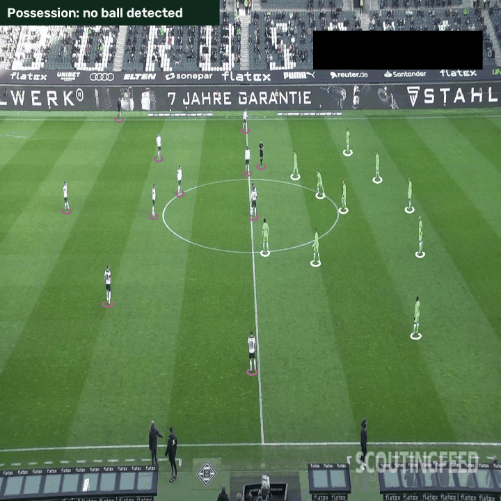
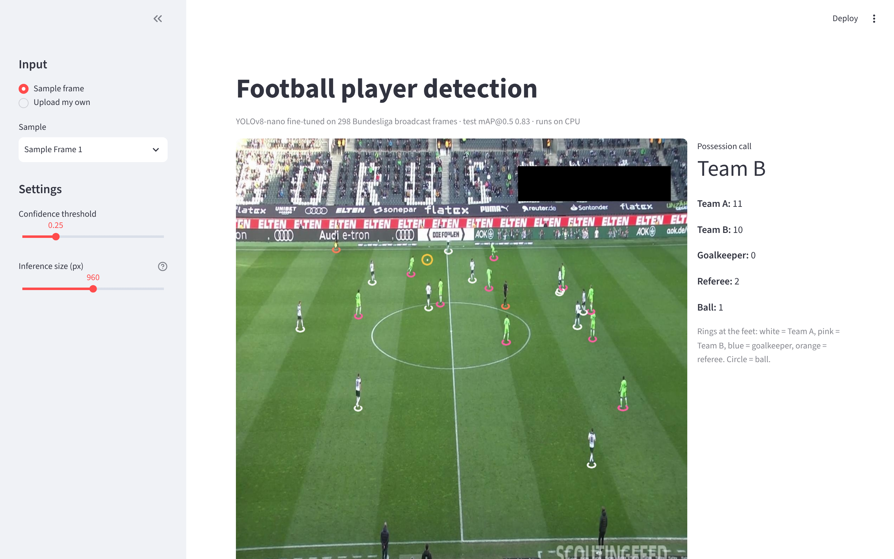

# Football Player Detection & Match Analytics (YOLOv8)

**A 3M-parameter YOLOv8 model that finds players, referees, goalkeepers and the ball in Bundesliga broadcast frames with 0.83 mAP@0.5 on a CPU, then splits the teams and estimates possession.**



## The problem

Tracking data usually comes from expensive multi-camera systems or hours of manual tagging. I wanted to know how far a small model can get straight from the broadcast feed on an ordinary laptop CPU, and where it breaks.

## Approach

1. **Data.** 372 labelled frames (8,905 objects) from 56 Bundesliga broadcast clips. Players outnumber balls 23 to 1, and the median ball is 8 px wide.
2. **Training.** Fine-tuned YOLOv8-nano from COCO weights at 640 px: 43 epochs in a 1.75-hour CPU budget.
3. **Resolution choice.** Compared inference at 640, 960 and 1280 px on the validation set. 960 px won; 1280 px is worse because objects then look bigger than anything seen in training.
4. **Evaluation.** The test split was untouched until the end: precision, recall and mAP per class, a confusion matrix and speed.
5. **Team identification.** The median Lab colour of the centre of each shirt is clustered into 2 teams with k-means. No kit labels needed.
6. **Possession.** The team of the player whose feet are nearest the ball (within 1.5 body-heights) gets possession for that frame.

## Results (held-out test set, 960 px)

| Class | Precision | Recall | mAP@0.5 | mAP@0.5:0.95 |
|---|---|---|---|---|
| Player | 0.98 | 0.97 | **0.99** | 0.79 |
| Referee | 0.93 | 0.88 | **0.95** | 0.63 |
| Goalkeeper | 0.94 | 0.78 | **0.93** | 0.72 |
| Ball | 0.95 | 0.38 | **0.43** | 0.18 |
| **All** | **0.95** | **0.75** | **0.83** | **0.58** |

- **People are solved:** 0.93–0.99 mAP@0.5 for players, referees and goalkeepers.
- **The ball is the bottleneck.** When the model calls a ball it is right 95% of the time, but it finds only 38% of them, so possession can be estimated in 47% of frames.
- **A cheap win.** Choosing the inference size on validation data lifted test mAP@0.5 from 0.79 to 0.83, and validation ball mAP@0.5 from 0.29 to 0.43, with no retraining.
- **Speed:** about 4 frames per second at 960 px on a 2-core CPU. No GPU.



## Run it

```bash
pip install -r requirements.txt

# Interactive demo: upload a frame, see detections, teams and the possession call
streamlit run app/streamlit_app.py

# Full pipeline: open the executed notebook (skips training if the weights exist)
jupyter notebook notebook/Football_Player_Detection_YOLOv8.ipynb

# Analytics on your own clip: detection + teams + possession, written to an annotated video
python src/analyse_match.py --source path/to/clip.mp4 --out outputs/clip_annotated.mp4
```

To retrain, download the dataset into `data/` first (see `data/README.md`).

## What's inside

```
├── app/                         Streamlit demo (deployable to Streamlit Community Cloud)
├── notebook/                    executed pipeline: data → training → evaluation → analytics
├── src/analyse_match.py         detection + teams + possession on any video or frame folder
├── runs/yolov8n_football/       trained weights (best.pt), training log and curves
├── charts/                      every figure in the report
├── outputs/                     test metrics, per-frame possession, annotated frame and GIF
├── docs/                        8-page technical report, literature review, 10-slide deck (PDF)
├── portfolio/                   data behind the website charts, with sources (facts.md)
└── data/                        data.yaml + dataset download instructions
```

## Honest limitations

- **Optimistic test scores.** Frames from the same clips appear in train, validation and test, so these are an upper bound for unseen matches. Holding out whole matches is the stricter test.
- **Possession is a proxy.** It counts frames, not seconds, and needs a detected ball.
- **Next steps:** train at 1280 px on a GPU or use tiled inference (SAHI) for the ball; add ByteTrack and a pitch homography for distance covered and heatmaps.

## Project history

Version 1 was my course project for Cognitive Sciences and Analytics (B.Tech CSBS, Semester 7, 2025), trained on Roboflow's hosted platform, scoring 0.82 mAP@0.5. This version rebuilds the whole pipeline in Python. It matches v1 overall, beats it on 3 of 4 classes, and adds the team and possession analytics.

## Data and credits

- **Dataset:** [football-players-detection v12](https://universe.roboflow.com/roboflow-jvuqo/football-players-detection-3zvbc), Roboflow Universe, CC BY 4.0. The three sample frames in `app/samples/` come from its test split.
- **Model:** [Ultralytics YOLOv8](https://github.com/ultralytics/ultralytics), AGPL-3.0. This repository is released under AGPL-3.0 to match.
- **Papers reviewed:** Wang & Li (2022) [doi:10.1155/2022/3540642](https://doi.org/10.1155/2022/3540642) · Merzah et al. (2024) [doi:10.18280/mmep.110113](https://doi.org/10.18280/mmep.110113) · Zhao (2024) [doi:10.1007/s44196-024-00565-x](https://doi.org/10.1007/s44196-024-00565-x)

---
**Shubham Tanna** · Python, Ultralytics YOLOv8, OpenCV, scikit-learn, pandas, Streamlit
<!-- SITE_LINK:work/player-detection -->
